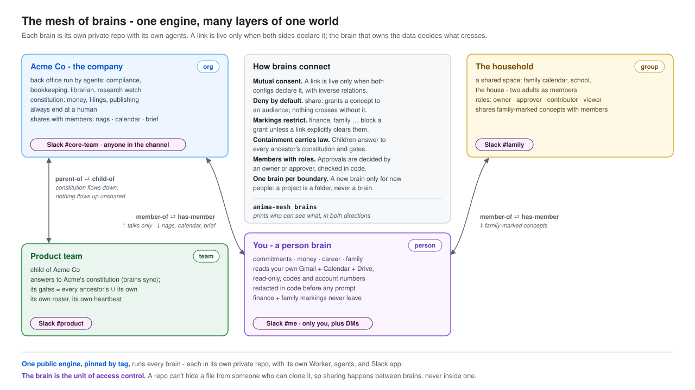
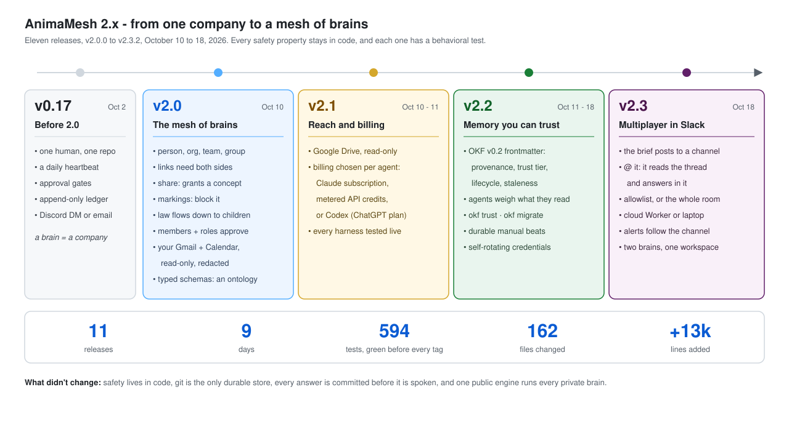

# AnimaMesh

**An engine for running your world with agents - your life, your company, and
the teams inside it - where humans keep a single role: the approval gate.**

Since 2.0, AnimaMesh animates a **mesh of brains**. Each brain is one layer of
someone's world, kept as a private, typed knowledge bundle in its own repo:

- a **person** brain is the working twin of one human's life (commitments,
  family, money, career, and the organizations they belong to);
- an **org** brain runs a company, the original **company-of-0**: a back
  office (compliance calendar, bookkeeping, librarianship, governance,
  research watch, inbound triage) operated by agents, with one human
  supplying judgment and signatures;
- **team** and **group** brains are the shared spaces in between (a unit of
  a company, a family, a project with outside collaborators).

Brains link to each other, and both sides must agree. The brain that owns
the data decides what crosses: `share:` grants it, `markings:` like
`finance` or `family` forbid it, and containment carries law down (a team
answers to its company's constitution). Members with roles make a brain
multi-player, and since v2.3 a brain can live in a Slack channel: the team
gets the daily brief there and @-mentions the persona to ask it things,
answered in thread by an agent that read the conversation. Every agent wakes on its own heartbeat, reads the knowledge
its brain gives it, does the preparable work, and reports back: *"here's
what I found, here's the draft, approve or edit."*

The initiative inverts: **you stop driving the work and start reviewing
it.** And because every brain is an **OKF knowledge bundle** (typed markdown
concepts under one validator, with optional schemas that make each type a
contract), a brain grows by adding *concept types*, not software: the first
front-office domain shelf is a [CRM](docs/okf-crm-domain.md) that lives in
the bundle itself, and the bundle as a whole reads as an ontology
([docs/ontology.md](docs/ontology.md)).

## Where it runs

**Cloud execution is the primary operating mode.** A normal AnimaMesh instance
runs continuously on Cloudflare Workers and Durable Objects against its private,
GitHub-hosted brain. The cloud heartbeat wakes agents on schedule, commits the
run evidence, delivers the daily brief, and accepts inbound directions while the
operator's laptop is closed.

The CLI remains a first-class companion for scaffolding and validating a brain,
manual or recovery runs, local development, and subprocess-only harnesses. It is
not the production scheduler. A third surface is the **interactive tier**:
`export-local` compiles any agent concept into Claude Code and opencode agent
artifacts, so the principal can *talk to* the mesh in a coding terminal with
the exact persona the scheduled tiers run
([docs/local-agents.md](docs/local-agents.md)). AnimaMesh is also not a shared
hosted service: each private instance deploys its own Workers, Durable
Objects, repository, and secrets from this public engine.

**Where the brain lives** is your choice since v2.4: a git repository (needed
for the cloud tier), or a OneDrive, SharePoint, Google Drive or Dropbox
folder for teams without git ([docs/storage.md](docs/storage.md)).

**Local mode** (v2.3.6) is the exception, for brains that hold someone
else's proprietary knowledge: `init --local` makes a brain the engine keeps
on the machine. No cloud tier, chat or mail delivery, cloud read sources,
web search or public issues, all refused in code; the same OKF memory,
focus file, layout and gated agents, run from the CLI or an interactive
session ([docs/local-only.md](docs/local-only.md)).

## How it's organized

**One Chief of Staff, many detached hands.**

- **The Chief of Staff is the hub** — an agentic coordinator and the single
  communication surface. One daily brief in; routed replies and approvals out.
  It assigns, sequences, and follows up on the specialists' work by *judgment*,
  not scripts — and it holds no state, so any restart resumes from the repo and
  the hub itself is replaceable.
- **The specialist agents are detached spokes** — small, decoupled, each
  independently deployed with its own heartbeat, its own model+harness choice,
  and least-privilege credentials. The bookkeeper never holds publishing keys;
  the research watcher never sees bank data. Spokes keep working when the hub
  is down. There is no monolith coordinator, no shared work queue, no phase
  loop — coordination happens through judgment over shared state.
- **The shared state is a brain repo** — a git-backed
  [OKF v0.2](https://github.com/GoogleCloudPlatform/open-knowledge-format) **knowledge bundle**: one
  **concept** per file, a declared `type` in YAML frontmatter, reserved
  `index.md` and `log.md`, links forming a **machine-checked knowledge
  graph** (the conformance pass verifies every link resolves), and v0.2's
  provenance, trust, and lifecycle fields (`sources:`, `verified:`,
  `status:`, `stale_after:`) so every agent can tell a checked fact from a
  lead and a current one from a stale one.
  Facts, decisions, events, the compliance calendar, the constitution, and
  every agent's own definition are concepts; so are front-office records —
  a CRM contact is a `crm-person` concept, not a row in someone else's SaaS.
  Plain markdown: readable by any human in any editor, consumable by any
  agent on any runtime, hostage to no vendor.

The engine is strictly **data-source-agnostic**: it never references any
particular organization. Your company's knowledge is your private brain repo;
this public engine is what animates it. It ships with an init that interviews
you and scaffolds a complete, conformant brain from an empty directory.

## The shape

```
your-brain/                      ← private instance (yours, never public)
  animamesh.config.json          ← the pairing: paths, identity, engine pin,
                                    brain kind + links to other brains
  bundle/                        ← the knowledge bundle — the ONE seam
    index.md · log.md            ← reserved files (okf_version; log newest first)
    constitution.md              ← immutable hard limits (machine-read gates)
    facts/ decisions/ events/    ← stable / dated-immutable / append-only
    ops/calendar.md              ← what agents wake up to check
    agents/*.md                  ← each agent IS a concept file
    crm/                         ← optional domain shelf: typed CRM concepts
                                    (orgs, people, engagements, interactions)
    ontology/                    ← optional: concept-type schemas (the contract)
    inherited/                   ← a child brain's materialized parent law
  ledger/actions.jsonl           ← append-only action ledger (audit seam)
  approvals/                     ← file-based needs-you gate (approval seam)
  reports/ drafts/               ← run artifacts
  cloud/                         ← this instance's Worker deploy config
```

## OKF is the data model — domains extend by type, not by code

Everything an instance knows is a **concept**; every concept declares a
**type**; the **conformance pass** (`pnpm cli validate`, profiles `okf` and
`animamesh`) enforces the shape — reserved files present, frontmatter
parseable, `type` declared, agent concepts carrying their chokepoint fields,
and the relative-link **knowledge graph resolving**.

Since **v2.2** the format is **OKF v0.2**, which matters because agents keep
writing the brain. Each concept can say where it came from (`sources:`), who
wrote it (`generated:`), who checked it against what (`verified:`, by a
`human:` or a machine actor), whether it is current (`status: draft |
stable | deprecated`), and when it goes stale (`stale_after:`). The engine
derives trust tiers from those fields in code, names stale, draft, and
deprecated knowledge in every agent's context, and reports it with
`anima-mesh okf trust`. `anima-mesh okf migrate` upgrades an older brain.
The writing conventions for AI sessions are in
[docs/okf-v0.2.md](docs/okf-v0.2.md). The checker is
deliberately type-agnostic beyond that: a new operational domain is a folder
of new concept types under the same validator, and every agent can read it
the moment it exists — no schema migration, no plugin, no vendor API.

**The first domain shelf is CRM** ([docs/okf-crm-domain.md](docs/okf-crm-domain.md)):
`crm-org`, `crm-person`, `crm-engagement`, and append-only `crm-interaction`
concepts, with relationship-first lifecycle stages and — the part no SaaS CRM
offers — **compliance screens encoded in the records themselves**, so agents
enforce an instance's legal boundaries as data rules rather than remembered
policy. It was promoted from a live instance, de-identified; the pattern
generalizes to any relationship-shaped domain (vendors, candidates, press).

## Layered and multi-player: the mesh of brains (2.0)



A brain is no longer only a company. Since v2.0 a brain is one **layer** of
someone's world (`person`, `org`, `team`, or `group`), and brains connect
([docs/layered-brains.md](docs/layered-brains.md)):

- **A person's life gets its own brain.** Commitments, family, money, and
  the organizations they belong to, with a personal chief of staff that
  reads the principal's own Gmail and Calendar through read-only scopes,
  with account numbers, one-time codes, and passwords redacted in code
  before any prompt sees them.
- **One brain per boundary, not per project.** One brain for yourself, one
  for each organization whose knowledge belongs to it, and one for each
  group of people you share work with. Every project, client and side effort
  is a folder in the brain it belongs to, and big files stay in the file
  cabinet (a drive the brain links to). A second brain for one owner only
  doubles the upkeep ([when to start a new brain](docs/layered-brains.md#when-to-start-a-new-brain-rarely)).
- **Brains link, and both sides must agree.** `member-of`/`has-member`,
  `child-of`/`parent-of`, `peer-of`: a link is live only when both configs
  declare it with inverse relations. A hub that declares `context-sources: [brains]`
  sees what each linked brain shares with it, read-only, every run.
- **The owner of the data decides what crosses.** `share:` markings grant a
  concept to an audience (deny by default); `markings:` like `finance` or
  `family` restrict it, conjunctively, unless a link explicitly clears them.
  `anima-mesh brains` shows exactly who can see what, in both directions.
- **Containment inherits law.** A team brain inside an org answers to the
  org's constitution: `brains sync` materializes it, and the gatekeeper
  unions every ancestor's gates with the team's own.
- **Multi-player is in the data model.** `identity.members` with roles
  (owner, approver, contributor, viewer); with members declared, only an
  owner or approver may decide an approval, checked in code.
- **Multi-player in a chat room (v2.3).** Each brain can have its own Slack
  app in its own channel: a person brain in a private channel for one, an
  org brain in the team channel, both in one workspace. Whoever the channel
  gate admits (`SLACK_ALLOWED_USER_IDS`, or `*` for "whoever is in the
  pinned channel") @-mentions the persona and gets an answer in thread;
  bots are never heard, so two brains' agents in one room cannot loop. Each
  answers from its own layer, reading across links only what `share:`
  grants allow ([docs/slack.md](docs/slack.md)).
- **Typed concepts make the twin an ontology.** A `concept-type` concept
  declares a type's properties, enums, and typed links, and conformance
  enforces it; `anima-mesh ontology` prints the type catalog and link graph
  ([docs/ontology.md](docs/ontology.md), with the Palantir mapping).

## Design rules the code enforces

- **Nothing consequential happens without a human.** Money movement, government
  filings, external publishing, credential exposure, and access expansion are
  constitutionally gated — enforced in the harness (code), never merely
  requested in a prompt.
- **Agentic core, deterministic gates.** Deterministic code does exactly four
  jobs: heartbeat plumbing, gate enforcement, ledger appends, and post-run
  verifiers. Everything between wake-up and gate is model judgment.
- **The one seam.** An agent is verified only by instance state before/after a
  run — repo diff, gate assertions, ledger completeness. Agent internals are
  never a test surface.
- **The autonomy ladder.** L1 report-only → L2 draft-for-approval → L3
  whitelisted reversible actions → L4 external actions, each behind a human
  gate, permanently. Every agent starts at L1 and earns promotion; the level is
  recorded in the agent's own concept file, so trust is an operational dial
  with a paper trail. Three L3 write paths ship today, all propose/dispose
  (a fenced block in the run's output, applied only through the gate,
  always ledgered): `schedule-update` (wake an agent for the next beat),
  `draft-write` (create/update artifacts under `drafts/` — session
  prep, outlines, quiz sheets — path-jailed, from beat AND direction runs,
  so the principal can reshape prep material by replying in chat), and
  `defect-report` (file a de-identified engine bug as a public GitHub
  issue — identity-leak guard, title dedup, and per-run cap are
  deterministic code; the model only writes the report).
- **Engine feedback is a core brain capability.** Every scaffolded brain
  carries `ops/engine-feedback.md`, required reading for both hub variants.
  It covers engine bugs and requested enhancements, the principal's narrow
  L3 `defect-report` grant, `engine.repo`, the dedicated
  `GITHUB_DEFECTS_TOKEN` on each filing runtime, privacy review, and filed
  versus fallback evidence. The [sample runbook](docs/sample-brain/bundle/ops/engine-feedback.md)
  shows the complete setup; new hubs still start at L1.
- **Drive reads can follow the task.** Agents with `google-drive` can
  search file and folder metadata across all dates, follow returned ids,
  and inspect requested images on vision providers. Beats and directions
  share bounded retrieval rounds and text/image budgets; the recent
  listing states its window and pagination. Access stays `drive.readonly`,
  and image payloads remain ephemeral
  ([setup and request formats](docs/layered-brains.md#search-older-drive-files-and-inspect-images)).
- **The model chokepoint.** Each agent concept declares its `model` and
  `harness`; swapping vendors is a config edit, never a rebuild. Shipped
  harnesses: `moonshot-api`, `anthropic-api`, and `anthropic-api-key` (pure
  fetch — the ones a cloud beat may run), `openai-codex` (pure fetch, but
  laptop-tier: chatgpt.com blocks Cloudflare Workers egress), `claude-code`
  (headless CLI), `claude-agent-sdk` and `claude-agent-sdk-api-key`
  (subprocess, laptop-tier by architecture), `codex` (headless Codex CLI),
  `opencode` (any opencode-configured model), `fake` (deterministic, for
  the regression suite). **Billing is part of the harness name**, so the
  brain chooses it per agent: `anthropic-api` / `claude-agent-sdk` /
  `claude-code` bill the Claude subscription, the `*-api-key` pair bills
  metered API credits, `codex` / `openai-codex` bill the ChatGPT plan's Codex
  quota, and `moonshot-api` bills Kimi. A credential that happens to be
  exported in the shell never moves a run from one to another. An instance can redirect a declared harness at runtime via
  `animamesh.config.json → cognition.overrides` — vendor trouble becomes a
  config edit, with the agent's declared identity untouched. Providers also
  **declare their capabilities** (file reads, web search), and the prompt
  states them to the agent — explicitly overriding the job description,
  because job text is written once while harnesses change per override.
  `web: <n>` frontmatter budgets web searches per run; `anthropic-api`
  grants them via Anthropic's server-side web-search tool in the same
  Messages call, Workers-safe. A refused budget is stated out loud in the
  prompt — silent empty research is not a reachable state. The same
  contract covers knowledge: `reads:` frontmatter declares the concept
  files a role requires, and the harness inlines them every run — or says
  `EMPTY` / `NOT AVAILABLE` in the prompt — so no-tool harnesses never run
  blind on files the job text names.
- **Cloud-first execution, one engine.** The primary runtime is a
  **Cloudflare Worker + Durable Object alarm** (`workers/heartbeat/`) over a
  GitHub-hosted brain. The laptop CLI runs the same heartbeat over a local
  directory for bootstrap, diagnostics, manual work, and subprocess-only
  harnesses; the `InstanceStore` seam swaps the transport. A cloud beat reads
  the instance as one tarball and lands all its artifacts as **one commit**
  (never force-pushed), so the repo stays the single test seam either way. No
  containers, no long-lived connections: the agent card says
  `streaming: false` on purpose.
- **Commercial capability is dual-gated.** Sales/lead/inbound-triage templates
  ship capable but refuse to run until the instance's legal boundary map is
  verified AND an explicit trigger or waiver is on file. Capability never
  outruns permission.
- **The mesh reaches its principal, and nags on request.** Delivery channels
  (Discord webhook/bot-DM, Slack channel, Notion, Gmail, console) carry the hub's brief; an
  optional `ops/nags.md` rides in every prompt so opted-into reminders repeat
  every heartbeat — with age — until done. Heartbeats are resilient (a failed
  spoke never kills the beat) and daily means *daily*: local-calendar
  semantics, immune to odd-hour manual runs. A due agent the cloud *cannot*
  run (subprocess-tier harness) is never a silent skip: the hub's prompt
  carries a scheduler note and the brief nags for the manual run owed.
- **The principal reaches the mesh, too — agentically.** A **direction** is
  the second entry point beside the heartbeat: an inbound message (Discord
  slash command via Ed25519-verified interactions, a Slack @-mention or DM
  via HMAC-verified Events API, or a polled Gmail inbox) becomes one
  agentic run — the model reads the message with full bundle
  context and decides the disposition itself; no keyword routing exists.
  Directions are sender-allowlisted and budget-capped at the channel edge,
  ledgered as `direction-*` actions, and reply only **after** the evidence
  commit lands. In a Slack channel the persona answers in the mention's
  thread, having read the conversation around it; bots are never heard, so
  two agents in one channel cannot loop each other. A separate `workers/web` Worker gives the principal a
  Google-OIDC dashboard (allowlist-only, nothing served unauthenticated).

## Quickstart: bootstrap locally, operate in cloud

Use the engine checkout to create and validate the private brain. These CLI
commands are the setup and operator path; scheduled production execution comes
from the per-instance cloud deployment that follows.

```bash
pnpm install
pnpm verify                  # typecheck + full regression suite

# scaffold a brain (interview, flags, or answers file)
pnpm cli init ../my-brain --org "Acme Co" --principal "Ada" \
  --agents compliance-ops,chief-of-staff

# or let a model refine the interview
pnpm cli init ../my-brain --answers answers.json --agentic opencode

# or a brain that never leaves this machine (no cloud, chat, web or Drive)
pnpm cli init ../work-brain --name "My work" --principal "Ada" --kind person --local

# or one that lives in a synced OneDrive / Google Drive folder instead of git
pnpm cli init "$HOME/OneDrive - Acme/my-brain" --name "My work" --principal "Ada" \
  --local --storage synced --provider onedrive
pnpm cli doctor --instance "$HOME/OneDrive - Acme/my-brain"   # storage health

# or just look: what the sample brain's beat would run (it needs no setup;
# copy it elsewhere first to run it for real, offline, brief to the console)
pnpm cli heartbeat --instance docs/sample-brain --dry-run

# no model credentials yet? add --harness fake: the deterministic provider
# runs the full loop (prompt → report → ledger → verifiers) offline, so you
# can see a complete agent run before wiring any vendor. Switch later by
# editing model/harness frontmatter in bundle/agents/*.md.
pnpm cli init ../my-brain --org "Acme Co" --principal "Ada" \
  --agents compliance-ops,chief-of-staff --harness fake

# a person's own brain (v2.0): person roster, Gmail/Calendar sources
pnpm cli init ../my-life --name "Ada Lovelace" --principal "Ada" \
  --principal-email ada@example.com --kind person --brain-id ada

pnpm cli validate ../my-brain          # OKF + animamesh conformance
pnpm cli brains --instance ../my-life  # links + who can see what, both directions
pnpm cli ontology --instance ../my-brain       # types, schemas, link graph
pnpm cli connect google --instance ../my-life  # one-time read-only consent
pnpm cli run compliance-ops --instance ../my-brain
pnpm cli run some-agent --instance github:owner/brain#branch   # zero local reads
pnpm cli heartbeat --instance ../my-brain      # run everything due; hub last
pnpm cli deliver --instance ../my-brain        # brief → discord/slack/notion/gmail/console
pnpm cli slack listen --instance ../my-brain   # answer Slack @-mentions from the laptop
pnpm cli card --instance ../my-brain           # the mesh's A2A agent card
pnpm cli gate list --instance ../my-brain
pnpm cli report --instance ../my-brain
```

The init's acceptance test is its demo: **empty directory in, conformant brain
out** — checked by the same validator every instance is checked by.

Prefer to see a brain already filled in and working? [docs/sample-brain/](docs/sample-brain/README.md)
is a complete scrubbed production instance — validate it, run it
credential-free, and copy its shapes into your own.

Next, push the brain to a private GitHub repository and follow
[Deploying the cloud tier](docs/deploying-cloud.md). That is the normal
always-on runtime: one Worker for heartbeats and directions, an optional
separately credentialed dashboard Worker, and one evidence commit per run.

## Documentation map

| Where | What |
|---|---|
| [docs/](docs/README.md) | **The operator's shelf — start here**, with a read order for new sessions |
| [docs/architecture.md](docs/architecture.md) | The whole system on one page: cloud diagram, Discord flows, design constraints |
| [docs/heartbeat-anatomy.md](docs/heartbeat-anatomy.md) | One beat, step by step: the DO alarm, the due decision, spokes-first/hub-last |
| [docs/a-typical-brain.md](docs/a-typical-brain.md) | Show-and-tell: a real production instance, de-identified — start here for a demo |
| [docs/sample-brain/](docs/sample-brain/README.md) | That instance as files: a complete scrubbed brain that validates and runs credential-free |
| [docs/starting-a-company.md](docs/starting-a-company.md) | Empty directory → a mesh running a real company (repeatable for company #2, #3, …) |
| [docs/deploying-cloud.md](docs/deploying-cloud.md) | Generic Cloudflare runbook: two Workers, secrets contract, Discord wiring |
| [docs/slack.md](docs/slack.md) | The persona in a Slack workspace: channel briefs, @-mention answers, an app manifest |
| [docs/local-agents.md](docs/local-agents.md) | The interactive tier: `export-local` agent artifacts + the `defect-report` loop |
| [docs/layered-brains.md](docs/layered-brains.md) | Person, org, team, and group brains: links, `share:`/`markings:`, inheritance, members, Gmail/Calendar |
| [docs/ontology.md](docs/ontology.md) | Concept-type schemas, the ontology view, and the mapping to Palantir's Ontology |
| [CHANGELOG.md](CHANGELOG.md) | Each minor release line: its value, maturity, and operator upgrade steps |
| [docs/engine-vs-instance.md](docs/engine-vs-instance.md) | The sorting rule: what belongs in this public engine vs a private brain |
| [docs/okf-v0.2.md](docs/okf-v0.2.md) | OKF v0.2 in AnimaMesh: provenance, trust, lifecycle; how AI writes a memory file; migrating |
| [docs/storage.md](docs/storage.md) | Where a brain lives: git, or a synced OneDrive / Google Drive / Dropbox folder, and `doctor` |
| [docs/local-only.md](docs/local-only.md) | Local mode: a brain for proprietary knowledge that never leaves the machine |
| [docs/focus.md](docs/focus.md) | The focus file (what matters right now) and the three-line brief |
| [docs/memory-layout.md](docs/memory-layout.md) | Where memory files go: an area, then a calendar year or a topic, at most three folders deep |
| [docs/okf-crm-domain.md](docs/okf-crm-domain.md) | The CRM domain shelf: typed concepts, lifecycle stages, compliance screens as data |
| [docs/learnings/](docs/learnings/README.md) | Hard-won platform knowledge (vendor gateways, Workers egress, …) with evidence |
| [CLAUDE.md](CLAUDE.md) | Working agreements for AI coding sessions in this repo |
| [src/README.md](src/README.md) | Module-by-module architecture map |
| [templates/README.md](templates/README.md) | The agent roster templates and their placeholder contract |
| [test/README.md](test/README.md) | What the regression suite guarantees and how to extend it |
| [workers/heartbeat/README.md](workers/heartbeat/README.md) | The cloud-tier heartbeat + direction Worker and how instances deploy it |
| [workers/web/README.md](workers/web/README.md) | The principal's dashboard Worker (Google OIDC, allowlist-only) |
| [references/README.md](references/README.md) | Proof-of-concept integrations that informed the design |

## Testing

`pnpm verify` = `tsc --noEmit` (a standing verifier) + the vitest regression
suite. Safety properties are tested as *behavior*: gated actions without
approvals throw, ladder violations throw, ungated commercial agents refuse to
run, corrupt ledgers fail verification, and every scaffolded brain must pass
conformance and complete a full agent run against the fake provider.

## Status



v2.4.0 (2026-10-27). Package name on npm to be confirmed; pinned consumers
reference the repo by tag. **2.0 is the mesh of brains**: person, org, team,
and group brains linked by mutual consent, owner-decided `share:` grants,
mandatory `markings:`, inherited law down a containment chain, member roles
on approvals, the principal's own Gmail and Calendar as redacted read-only
sources, and concept-type schemas that make a brain an ontology. It is a
major version because it changes what the engine is for: one brain was one
company; now a brain is a layer, and the engine reasons across layers. A
brain without a `brain` block runs exactly as it did on 0.17, so the upgrade
itself is a pin bump.

Since 2.0: **v2.1** adds the `google-drive` read source on the same
read-only Google consent as Gmail and Calendar. **v2.1.1** makes billing a
harness choice. `anthropic-api-key` and `claude-agent-sdk-api-key` run
Claude on metered API credits, and `codex` and `openai-codex` run on a
ChatGPT plan. Subprocesses never pick up a stray exported key. A
subscription Codex agent runs on the laptop only, because chatgpt.com
blocks Cloudflare Workers egress. **v2.2** moves every brain to OKF v0.2:
provenance, trust tiers, lifecycle, and staleness as frontmatter the engine
reads, a newest-first log, and `okf trust` / `okf migrate`. **v2.3** puts
the persona in Slack: the daily brief posts to a channel, and an @-mention
in an allowed channel (or a DM to the app) becomes a direction answered in
its thread, with the surrounding conversation as context. It runs from the
cloud Worker (`/slack/events`) or, with no public endpoint, from the laptop
(`slack listen`). Channel membership can be the allowlist (`*`), and cloud
failure alerts follow each brain's own channels. Later 2.3 patches add the
[focus file and three-line brief](docs/focus.md) (what matters right now,
and a notification you can read), memory two tiers deep by year or topic,
[local mode](docs/local-only.md) for proprietary brains, and a working
agreement (`CLAUDE.md`/`AGENTS.md`) in every new brain. **v2.4** makes a
brain portable: it can live in git or in a OneDrive, SharePoint, Google
Drive or Dropbox folder, with per-machine ledger shards, one runner,
atomic writes, conflict copies flagged in the brief, and `anima-mesh
doctor` to check the folder ([docs/storage.md](docs/storage.md)).

The cloud tier introduced in v0.3 is the primary execution path; the CLI
remains the bootstrap, operator, and subprocess-harness path. The 0.x lines
before 2.0 extend one theme, **nothing the mesh cannot do is ever silent**:
v0.17 ask-driven retrieval (`read-request`); v0.16 recent events inlined for
every agent; v0.15 streamed `anthropic-api`; v0.14 due-but-cloud-unrunnable
agents nag through the brief; v0.13 role-declared reads; v0.12 capability
truth and real server-side web search; v0.11 the interactive tier and the
defect loop; v0.10 the draft surface; v0.9 the schedule surface; v0.8
GitHub App auth. See [CHANGELOG.md](CHANGELOG.md) for the value and upgrade boundary of each minor
line, and [docs/learnings/](docs/learnings/README.md) for evidence-backed
platform lessons.

Apache-2.0 © 2026 Jack Jin — see [LICENSE](LICENSE)
