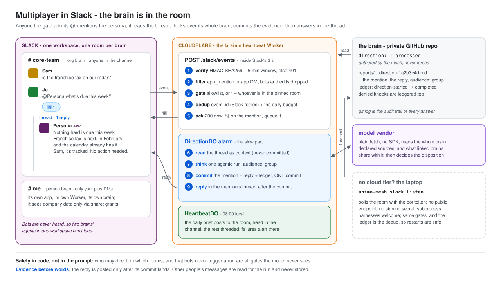

# Slack - the persona in your workspace (v2.3)



Slack gives the mesh two surfaces, either of which works alone:

1. **Brief delivery to a channel.** `slack` is a delivery channel like
   `discord` or `gmail`: the daily brief posts into a channel, rendered as
   Markdown. Since v2.3.5 the channel message is the brief's three lines;
   the short Also list and a link to the full report go in its thread, so a
   shared channel shows one short brief per day ([focus and the brief](focus.md)).
2. **Answering when mentioned.** Someone @-mentions the persona in a
   channel it was invited to (or DMs the app), and it answers in that
   thread after reading the conversation around the mention. This is the
   Discord direction pipeline with a group-shaped door: same queue, same
   budget, same one-commit-of-evidence-before-the-reply.

Delivery runs on both tiers (laptop `deliver`/`heartbeat` and the cloud
beat). Mentions run on either tier too:

- **Cloud:** the heartbeat Worker's `POST /slack/events` - Slack pushes each
  event, so answers start within seconds. Needs the Worker deployed and the
  signing secret.
- **Laptop (v2.3.1):** `anima-mesh slack listen` polls the channel with the
  bot token - no public endpoint, no signing secret, and it runs agents on
  subprocess harnesses (`claude-code`) the cloud cannot host. Use it for a
  brain with no cloud tier.

## 1. Create the Slack app from a manifest

At [api.slack.com/apps](https://api.slack.com/apps) → **Create New App** →
**From a manifest** → pick the workspace → paste this, replacing the two
placeholders:

```yaml
display_information:
  name: <Persona Name>
  description: Chief of staff for this brain
features:
  bot_user:
    display_name: <Persona Name>
    always_online: true
  app_home:
    messages_tab_enabled: true
    messages_tab_read_only_enabled: false
oauth_config:
  scopes:
    bot:
      - app_mentions:read   # hear @-mentions
      - chat:write          # post the brief and replies
      - reactions:write     # the "seen, thinking" reaction
      - channels:history    # read the conversation around a mention (public channels)
      - groups:history      # same, private channels
      - im:history          # DMs to the app
settings:
  event_subscriptions:
    request_url: https://<worker-host>/slack/events
    bot_events:
      - app_mention
      - message.im
  org_deploy_enabled: false
  socket_mode_enabled: false
```

Delivery alone needs only `chat:write`. Drop `settings.event_subscriptions`
(and the history/mention scopes) if you only want the brief. Slack verifies
the request URL immediately, so deploy the Worker with
`SLACK_SIGNING_SECRET` set first (step 3), or add the URL afterwards under
**Event Subscriptions**.

Then **Install to Workspace** and copy:

- **Bot User OAuth Token** (`xoxb-...`) → `SLACK_BOT_TOKEN`
- **Basic Information → Signing Secret** → `SLACK_SIGNING_SECRET`

## 2. Collect the ids

Slack ids, not names, gate everything:

- **Channel id**: open the channel → channel name → the id at the bottom of
  the About tab (`C...`). Invite the app into it (`/invite @<Persona Name>`);
  a private channel needs the invite before the bot can post or read.
- **User ids** of everyone allowed to direct the persona: profile → ⋮ →
  **Copy member ID** (`U...`). Start with the principal alone.

## 3. Configure

Brain config (`animamesh.config.json`) - add `slack` to the delivery list:

```json
"delivery": { "deliverAgent": "chief-of-staff", "channels": ["slack"] }
```

Heartbeat Worker vars (`cloud/wrangler.jsonc`):

| Var | Meaning |
|---|---|
| `SLACK_CHANNEL_ID` | where the brief posts in bot mode (`C...`/`G...`; a `U...` id posts to the app's DM with that person) |
| `SLACK_ALLOWED_USER_IDS` | comma-separated user ids who may direct the persona. **Absent = nobody**: a fresh install answers no one until you opt people in. `*` (v2.3.2) = whoever can post in the channels `SLACK_ALLOWED_CHANNEL_IDS` pins - Slack's channel membership becomes the allowlist. `*` is refused without that channel list, and never opens DMs |
| `SLACK_ALLOWED_CHANNEL_IDS` | optional comma-separated channels where mentions are answered. Absent = any channel the app is in. DMs from allowed users always pass |

Secrets (`wrangler secret put`): `SLACK_BOT_TOKEN`, `SLACK_SIGNING_SECRET`.
`SLACK_WEBHOOK_URL` (an incoming webhook) is a delivery-only alternative to
the bot token: one channel, fixed at install time, no threading. Bot mode
wins when both are set.

On the laptop tier, put `SLACK_BOT_TOKEN` + `SLACK_CHANNEL_ID` (or
`SLACK_WEBHOOK_URL`) in the instance's `.env.local`; `anima-mesh deliver`
then posts the latest brief.

## Laptop tier: `slack listen`

```bash
pnpm cli slack listen --instance ../my-brain              # poll every 30 s until Ctrl-C
pnpm cli slack listen --instance ../my-brain --once       # one pass (cron-friendly)
```

It reads `.env.local`: `SLACK_BOT_TOKEN`, `SLACK_ALLOWED_USER_IDS` (it
refuses to start when empty), and `SLACK_ALLOWED_CHANNEL_IDS` or else
`SLACK_CHANNEL_ID`. Each pass looks back `--lookback` minutes (default 60)
over top-level messages and recently active threads. The ledger is the
dedup: a mention whose ts already appears as a slack `messageId`
(answered, failed, or denied) is never handled again, so restarts are safe
and there is no cursor file. Gates, the 👀 acknowledgment, the conversation
context, the `audience: "group"` run and the thread reply match the cloud
path below. It needs the history scopes, which the manifest already grants.

## How a mention is handled (cloud)

```
@persona in #team ──► POST /slack/events
                       ├─ HMAC-SHA256 over v0:{ts}:{body}, 5-min replay window → else 401
                       ├─ url_verification → echo the challenge
                       ├─ not app_mention / DM, or bot-authored, or an edit → 200, dropped
                       ├─ sender ∉ SLACK_ALLOWED_USER_IDS, or channel ∉ SLACK_ALLOWED_CHANNEL_IDS
                       │     → 200, silent; recorded, ledgered as direction-denied on the next drain
                       ├─ DirectionDO /enqueue: event_id dedup (Slack retries), daily budget
                       │     → over budget: ephemeral notice to the sender only
                       └─ 200 within Slack's 3 s + 👀 reaction on the mention
DirectionDO alarm ──► read the thread (or the channel's recent messages)
                  ──► runDirectionCore, audience "group" ──► ONE commit
                  ──► reply in the mention's thread (markdown block)
```

What the persona is told, and what stays in code:

- **In code:** who may direct (user allowlist), where (channel allowlist),
  that bots are never heard (two agents in one channel cannot loop each
  other), dedup, the budget, L1 report-only, gates, and the evidence commit
  before any reply.
- **In the prompt (judgment):** that the reply is read by the whole channel
  and the sender may be a teammate rather than the principal, so private
  matters belong in a DM; and the surrounding conversation, framed as other
  participants' words, never instructions.
- **Kept out of the repo:** the conversation context. The direction artifact
  records the mention's text and the reply (plus `audience: group`); other
  people's messages are read for the run and not committed.

## Failure alerts

When a cloud beat fails, the alert goes to the brain's own chat delivery
channels (`slack` and/or `discord` in `delivery.channels`), or to every
chat channel with credentials when the beat died before reading the
config (v2.3.2). A brain moved from Discord to Slack alerts in Slack, even
if its Discord secrets are still on the Worker.

## Choosing the rooms

The brain's whole context can reach a mention's reply. Treat
`SLACK_ALLOWED_CHANNEL_IDS` as the boundary of who may hear from this brain:
a private channel with the people you would show your brief to. A personal
brain in a workspace shared with friends usually wants exactly one allowed
channel plus DMs. A team brain can use `SLACK_ALLOWED_USER_IDS=*` with one
pinned team channel, so whoever is in that channel may direct it and
membership is managed in Slack.
